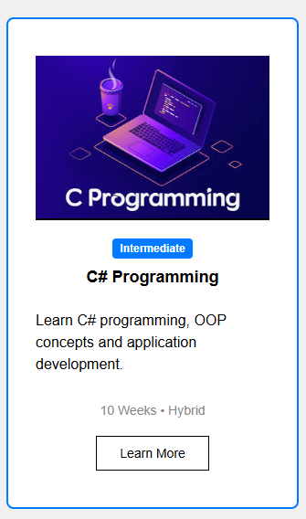
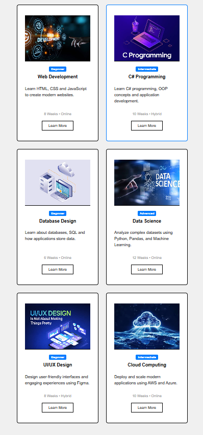
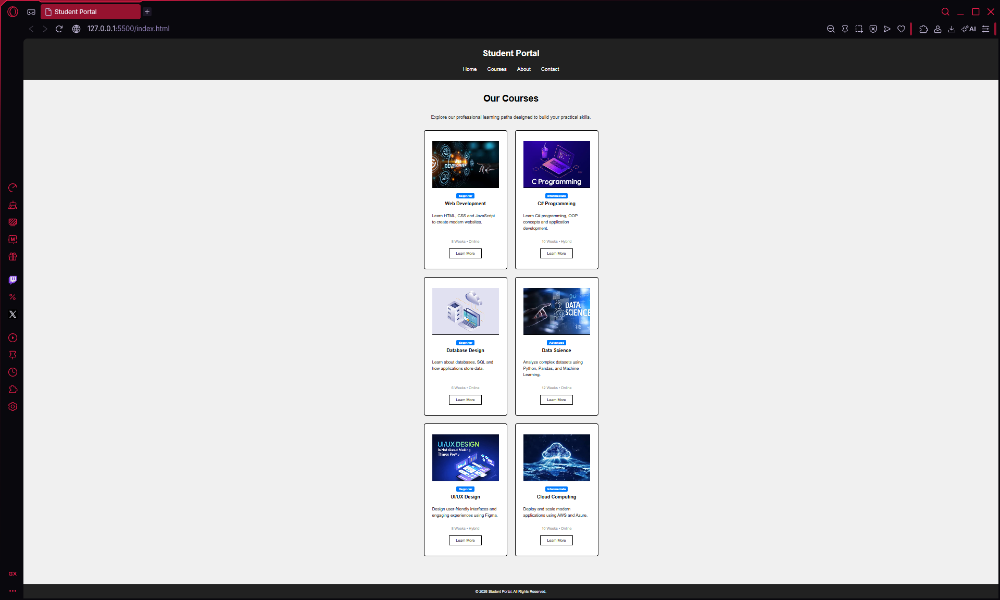

HTML & CSS — Navigation Bar and Card Design

SohitLama
2602412421
BscSE(Fundamentals of Software Engineering)
Level-4 Sem-1
Navigation Bar and Card Design

I created a webpage (student portal) where i have inserted a navigation bar and right below it i have our courses where i have built 6 different cards containing each different courses.

The technologies that i have used in this work are 
    HTML5
    CSS3
    CSS Flexbox
    CSS Grid
    Responsive CSS

Teacher's Lecture 
    -I learned the difference between generic 
 tags and semantic tags, as well as how to control element spacing using margin and padding.
     learned about classes id difference between them learned about styling the webpage by adding different background colors editing fonts font-sizes type and all from basics to flexbox create card navigation bar and so on.
    -I used them because they are all the basics to create a attractive webpage. 
    -I used them all in this assignment as they were all the things i requried to complete the assignment. 
Gemini(AI)
    -I learned how to properly center cards how to add transition in hover add semi colors(2 color mix/blend) in backgrounds how to properly use flex and used it in this assignment.

## Navigation Bar

## Card Design

## Card Layout

## Responsive Design

Semantic HTML: I learned to use meaningful tags like <header>, <main>, and <nav> to logically structure the webpage for better accessibility and readability.

CSS Selectors: I learned how to use class selectors to target and style specific elements independently without accidentally affecting the rest of the page.

Box Model: I learned how to control an element's overall size and layout on the page by manipulating its margins, borders, and padding.

Flexbox: I learned to use this one-dimensional layout system to neatly align items in a single row or column, such as centering my navigation links.

Grid: I learned to use this two-dimensional layout system to build a flexible, multi-column structure for displaying the course cards simultaneously.

Typography: I learned how to establish a clear visual hierarchy and improve readability by adjusting font sizes, weights, and line heights across different text elements.

Spacing: I learned how to use margins, padding, and the gap property to give elements breathing room and prevent a cluttered, unprofessional design.

Hover Effects: I learned how to use the :hover pseudo-class and transition property to add smooth, interactive visual feedback to buttons and cards.

Responsive Design: I learned how to use @media queries to automatically adapt the layout and column structure for different screen sizes like mobile phones and desktop monitors.

Challenge 1: Inconsistent Card Heights

Because the course descriptions varied in length, the cards ended up being different heights, which made the grid look messy and the buttons misaligned.I solved this by making the card container a flexbox (display: flex; flex-direction: column;) and adding flex-grow: 1 to the text description class. This forced the text area to expand to fill any empty space, perfectly pushing all buttons to the bottom edge regardless of the text length.

Challenge 2: Image Distortion

When I added thumbnail images to the cards and gave them a fixed height to keep the layout uniform, the images became stretched and squished depending on the screen size.I researched image formatting and discovered the object-fit: cover CSS property. Applying this to the image class ensured the images dynamically cropped to fit the container perfectly without distorting their original aspect ratio.

https://github.com/Sohit7794/HTML-CSS-Practical-Assignment.git